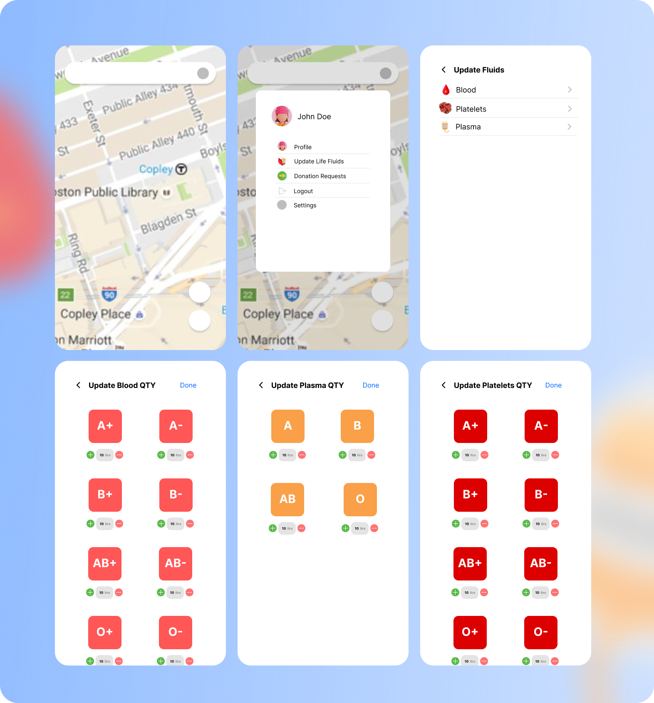
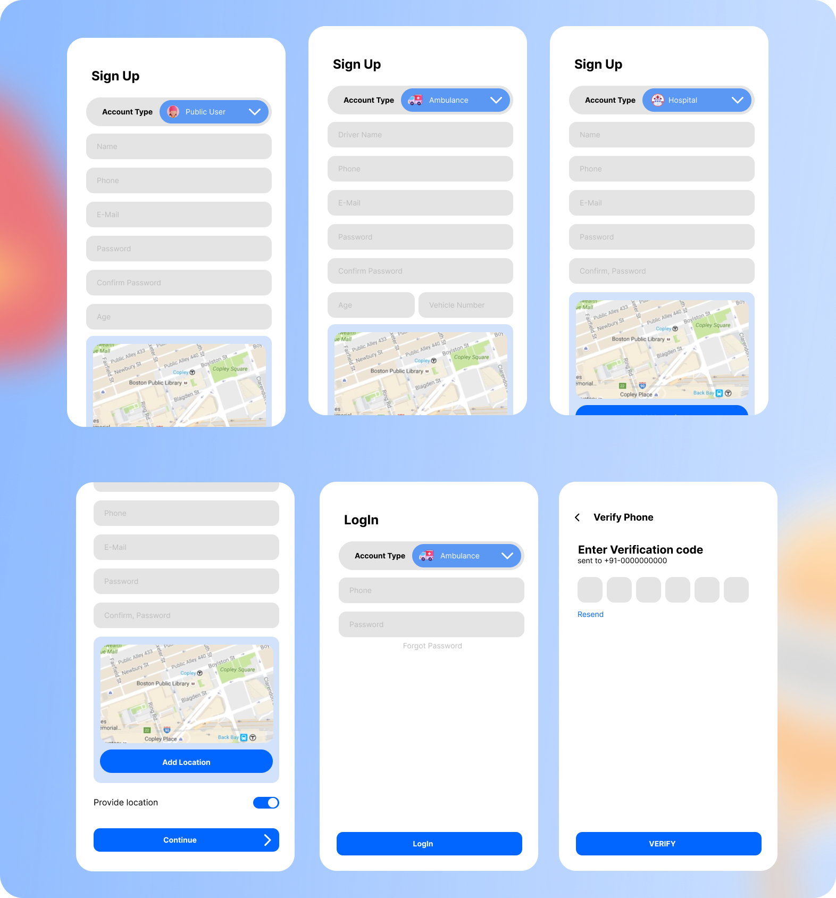

# Healthy Kingdom

  
  

## Problem
When there is an case of Medical Emergency in India, there are many cases when peoples are unable to get the required life-fluid i.e. Blood, Platelets, Plasma, etc. this is may be wrong information, less knowledge, lack of connections, etc.

## 💮 Solution
It's an app that shows availability of life fluids ( Blood, Plasma, Platelets ) in the connected Hospitals over the globe. 
Hospitals can also create a donation request of specific life-fluid in case of crisis so that peoples can donate to whom who needs it in emergency and may be it can save someone's life ❤.

## Features
* Show all conected hospitals over globe on map.
* Show available life-fluids ( Blood, Plasma, Fluids ) in connected hospitals.
* Hospitals can create donation request of life-fluids.
* Hospitals can regiter by providing their legal documents and other required details
* Individuals can register using their phone number

### <i>more updates to be added soon...</i>
